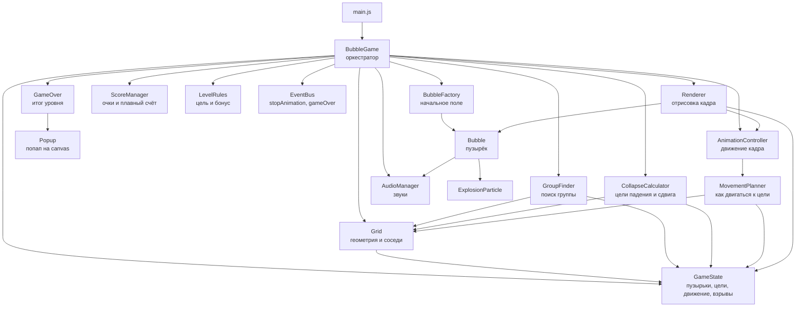
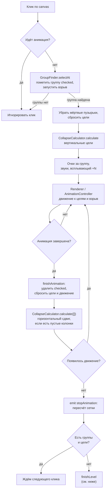
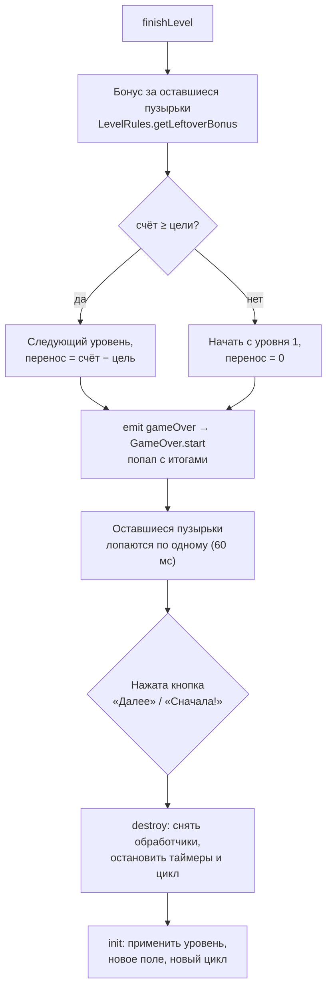

# Bubble Breaker v2

Браузерная головоломка на canvas: на поле 10×10 лопаются группы из соседних пузырьков одного цвета. Цель каждого уровня — набрать определённое количество очков. Проект написан на чистом JavaScript (ES-модули), без сборщика и внешних зависимостей.

## Запуск

Проект использует ES-модули и загружает звук через `fetch`, поэтому открывать `index.html` двойным кликом не стоит (браузер заблокирует модули по `file://`). Нужен любой статический сервер из корня проекта, например:

```bash
python -m http.server 8000
# затем открыть http://localhost:8000
```

## Правила игры

- **Ход** — клик левой кнопкой по пузырьку. Лопается вся группа одноцветных пузырьков, связанных по сторонам (сверху, снизу, слева, справа). Группа из одного пузырька не лопается.
- **Очки за группу** — `размер × очки_за_пузырёк × множитель`, где очки за пузырёк — `15 + 2 × (номер уровня − 1)`: на уровне 1 — 15, на уровне 2 — 17, на уровне 3 — 19 и т. д.:

  | Размер группы | Множитель |
  |---------------|-----------|
  | 2–3           | ×1        |
  | 4–7           | ×2        |
  | 8–9           | ×3        |
  | 10–11         | ×4        |
  | 12 и больше   | ×5        |

  Пример: группа из 5 пузырьков на уровне 1 даёт `5 × 15 × 2 = 150` очков, на уровне 2 — `5 × 17 × 2 = 170` очков.
- **Падение и сдвиг** — после лопания пузырьки над пустотой падают вниз (вертикальная фаза). Когда падать больше нечему, колонки справа от полностью опустевших колонок сдвигаются влево (горизонтальная фаза).
- **Цель уровня** — `1000 + 500 × (номер уровня − 1)`: уровень 1 — 1000, уровень 2 — 1500, уровень 3 — 2000 и т. д. Когда счёт достигает цели, появляется баннер «Цель достигнута», но уровень продолжается.
- **Конец уровня** — наступает, когда на поле не осталось ни одной группы из двух и более пузырьков.
  - Оставшиеся пузырьки дают бонус: при 1–4 штуках по 100 очков за каждый, при 5–9 — по 50, при 10 и больше бонуса нет.
  - Бонус добавляется к счёту, после чего оставшиеся пузырьки лопаются по одному.
- **Победа** (счёт ≥ цели) — переход на следующий уровень. Излишек `счёт − цель` переносится в начальный счёт следующего уровня.
- **Поражение** (счёт < цели) — игра начинается заново с первого уровня без переноса очков.

Счёт в верхней панели (`Уровень N | Счёт: X / цель`) растёт плавно, со скоростью около 300 очков в секунду.

## Структура проекта

```text
bubble-breaker-v2/
├── index.html              # разметка: панель счёта и canvas
├── css/main.css            # стили страницы, панели, попапа и всплывающих надписей
├── assets/
│   ├── audio/pop.mp3       # звук лопания
│   └── images/bubbles/     # SVG пузырьков: blue, green, purple, red, yellow
└── js/
    ├── main.js             # точка входа: создаёт BubbleGame и запускает игру
    ├── config.js           # CONFIG (размер поля, скорость, обводка) и COLORS (цвета)
    ├── game/
    │   ├── BubbleGame.js          # оркестратор: ввод, ход, конец уровня, цикл кадров
    │   ├── BubbleFactory.js       # создание начального поля
    │   ├── GroupFinder.js         # поиск группы одноцветных пузырьков под курсором
    │   ├── CollapseCalculator.js  # расчёт конечных позиций для падения и сдвига
    │   ├── MovementPlanner.js     # покадровое движение одного пузырька к цели
    │   ├── AnimationController.js # обновление движения всех пузырьков кадра
    │   ├── Renderer.js            # отрисовка кадра и сигнал об окончании анимации
    │   ├── GameOver.js            # текст и кнопка попапа по итогам уровня
    │   ├── LevelRules.js          # цель уровня и бонус за оставшиеся пузырьки
    │   └── EventBus.js            # простая шина событий (stopAnimation, gameOver)
    ├── grid/Grid.js               # геометрия сетки, соседи по сторонам, пересчёт позиций
    ├── state/GameState.js         # общее состояние: пузырьки, цели, движущиеся и взрывающиеся
    ├── models/
    │   ├── Bubble.js              # пузырёк: позиция, отрисовка, взрыв, звук
    │   └── ExplosionParticle.js   # частица взрыва
    ├── audio/AudioManager.js      # AudioContext, загрузка и воспроизведение звуков
    ├── ui/Popup/Popup.js          # модальный попап поверх canvas
    └── utils/ScoreManager.js      # подсчёт очков и плавный показ счёта
```

## Архитектура

`BubbleGame` — единственная точка сборки: он создаёт все подсистемы при каждом (ре)старте уровня и связывает их между собой. Остальные модули не знают друг о друге напрямую, а получают нужные зависимости через конструктор.



### Ответственность модулей

**Оркестрация**

- `BubbleGame` — обрабатывает клик, запускает ход, начисляет очки, решает конец уровня, держит игровой цикл `requestAnimationFrame`, перезапускает игру.

**Состояние и геометрия**

- `GameState` — массив `bubbles` (индекс = `row × columns + column`), цели падения и сдвига (`targets.bottom`, `targets.left`), карты движущихся (`moving`) и взрывающихся (`exploding`) пузырьков. Свойство `isAnimating` говорит, идёт ли анимация.
- `Grid` — размер ячейки (`canvas.width / columns`), координаты центров ячеек, соседи сверху, снизу, слева и справа (слева и справа — только в той же строке), пересчёт строки и колонки пузырька по его координатам.

**Логика хода**

- `GroupFinder` — находит пузырёк под курсором по его границам и помечает всю связную группу одного цвета (`checked`), запуская у каждого взрыв.
- `CollapseCalculator` — не двигает пузырьки, а только считает их целевые координаты:
  - `calculateVerticalTargets` — для каждой колонки считает, на сколько строк опускается каждый оставшийся пузырёк;
  - `calculateHorizontalTargets` — если колонка полностью пуста, сдвигает все колонки правее неё влево.

**Движение и анимация**

- `MovementPlanner` — отвечает на вопросы, как двигаться к уже рассчитанной цели:
  1. `getDirection()` — куда двигаться (`bottom` или `left`);
  2. `getTargetPosition()` — координата остановки;
  3. `isBlockedByNeighbor()` — упёрся ли пузырёк в соседа;
  4. `hasReachedTarget()` — достигнута ли цель;
  5. `clampToTarget()` — выставляет пузырёк ровно в точку остановки;
  6. `move()` — один шаг на `speed` пикселей;
  7. `update()` — объединяет всё вышеперечисленное для одного кадра.
- `AnimationController` — на каждом кадре вызывает `MovementPlanner.update` для всех пузырьков, у которых есть цель, и возвращает, закончилась ли анимация.
- `Renderer` — на каждом кадре: двигает анимацию, очищает canvas, рисует пузырьки и взрывы, а когда анимация только что завершилась, вызывает `finishAnimation` в `BubbleGame`.

**Очки и правила уровня**

- `ScoreManager` — `addGroup(count)` начисляет очки за группу по таблице множителей, `addBonus(points)` — бонус в конце уровня. `tick(deltaTime)` двигает отображаемый счёт к реальному со скоростью 300 очков в секунду.
- `LevelRules` — `getLevelTarget(level)`, `getPointsPerBubble(level)` и `getLeftoverBonus(remaining)`. Вся «арифметика уровня» собрана здесь.

**Интерфейс и звук**

- `GameOver` — конец уровня целиком:
  - `resolve()` начисляет бонус за оставшиеся пузырьки, решает победу или поражение и считает перенос очков и следующий уровень;
  - `start()` собирает строки попапа и задаёт кнопку («Далее» при победе, «Сначала!» при поражении). При закрытии попапа вызывает `destroy` и `init` у `BubbleGame`.
- `Popup` — модальный блок, который центрируется по canvas и занимает 90% его ширины. Шрифт уменьшается, если текст не помещается по высоте.
- `AudioManager` — создаёт `AudioContext` при первом нажатии мыши (требование браузеров), загружает `pop.mp3` и проигрывает его с нужной громкостью.
- `EventBus` — синхронная шина событий. Используется для `stopAnimation` (пересчитать сетку после анимации) и `gameOver` (показать попап).

## Поток хода

От клика до следующего хода:



Пояснения:

- Вертикальное падение и горизонтальный сдвиг выполняются последовательно: сначала все пузырьки падают, затем, если появились пустые колонки, колонки сдвигаются. Оба этапа заканчиваются вызовом `finishAnimation`.
- Очки начисляются сразу в `ScoreManager`, а на экране счёт догоняет их плавно в цикле `loop()`.

## Конец уровня



Цель уровня проверяется только в конце уровня. Баннер «Цель достигнута» появляется раньше, в момент, когда счёт впервые достигает цели.

## Игровой цикл

`BubbleGame.loop()` вызывается через `requestAnimationFrame` и на каждом кадре:

1. считает `deltaTime` и обновляет отображаемый счёт (`ScoreManager.tick`);
2. обновляет текст панели счёта;
3. вызывает `Renderer.render()`, который двигает пузырьки, рисует поле и при завершении анимации вызывает `finishAnimation`.

## Конфигурация

| Где | Параметр | Значение | Что делает |
|-----|----------|----------|------------|
| `config.js` | `rows`, `columns` | 10, 10 | размер поля |
| `config.js` | `speed` | 10 | шаг движения пузырька, пикселей за кадр |
| `config.js` | `strokeColor`, `strokeWidth` | `#222`, 2 | обводка (используется, если SVG не загрузился) |
| `config.js` | `textFontSize` | 12 | размер текста внутри пузырька |
| `config.js` | `COLORS` | blue, green, purple, red, yellow | палитра; цвет выбирается случайно |
| `LevelRules.js` | `FIRST_LEVEL_TARGET`, `TARGET_STEP` | 1000, 500 | цель уровня |
| `LevelRules.js` | `getLeftoverBonus` | 100 / 50 / 0 | бонус за оставшиеся пузырьки |
| `LevelRules.js` | `FIRST_LEVEL_POINTS_PER_BUBBLE`, `POINTS_PER_BUBBLE_STEP` | 15, 2 | очков за один пузырёк в группе на первом уровне и прирост за каждый следующий |
| `ScoreManager.js` | `speed` | 300 | скорость роста отображаемого счёта, очков в секунду |
| `BubbleGame.js` | `POP_INTERVAL_MS` | 60 | пауза между лопающимися пузырьками в конце уровня |

Для отладки в `BubbleFactory.js` есть закомментированная фиксированная раскладка `types`, которую можно подставить вместо случайных цветов.

## Важный принцип: расчёт цели отделён от анимации

Раньше один метод одновременно определял направление, искал соседей, считал цель, проверял столкновение и запускал анимацию. Теперь эти обязанности разделены:

```text
клик
  ↓
GroupFinder            — какая группа лопается
  ↓
CollapseCalculator     — куда должен прийти каждый пузырёк (цель)
  ↓
GameState.targets      — цели хранятся, а не пересчитываются каждый кадр
  ↓
AnimationController    — кто ещё движется
  ↓
MovementPlanner        — как шагнуть к цели на этом кадре
  ↓
Bubble.x / Bubble.y    — текущая позиция
  ↓
Renderer               — отрисовка
```

Анимация больше не ищет конечную точку на каждом кадре. Это упрощает замену движения на более сложное: движение с `deltaTime`, easing, разные скорости по направлениям, физику или предварительно рассчитанную траекторию. Для этого достаточно поменять `MovementPlanner`, не трогая расчёт целей.

Модель `bottom` / `left` и алгоритм расчёта целей сохранены из прежней версии; рефакторинг не меняет правил игры.

## История изменений

- **Первый коммит** — базовая игра: поле, группы, падение и сдвиг, счёт.
- **Вторая итерация (рефакторинг движения)** — `MovementPlanner` и `AnimationController` выделены из старого `checkMove()`, `Renderer` отвечает только за отрисовку.
- **Add GameOver** — цели уровней с переносом очков, бонус за оставшиеся пузырьки, попап `GameOver` и `LevelRules`.
